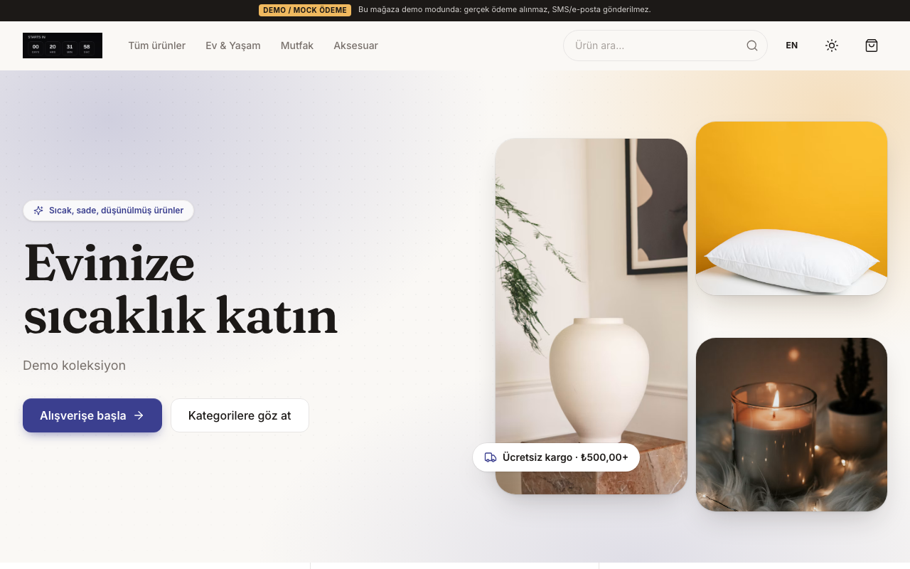
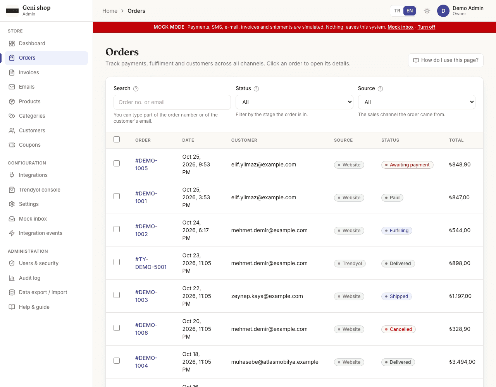

<div align="center">

<h1></h1>

**Your store. Your infrastructure. Your freedom.**

Open-source e-commerce platform that runs on a single Cloudflare Worker and a D1 database in your own Cloudflare account.
Storefront, admin, marketplace, shipping, e-invoicing and notifications in one deployment.

[Türkçe](README.md) · [English](README.en.md)

[](LICENSE)
[](https://www.typescriptlang.org/)
[](https://workers.cloudflare.com/)
[](#integrations)

[](https://deploy.workers.cloudflare.com/?url=https://github.com/berkayoztunc/openshelf)

</div>

<div align="center">

 

<sub>Storefront (left) and the admin orders screen (right).</sub>

</div>

## Contents

- [Why OpenShelf](#why-openshelf)
- [Features](#features)
- [Integrations](#integrations)
- [Quick start](#quick-start)
- [Configuration](#configuration)
- [Automations and scheduled jobs](#automations-and-scheduled-jobs)
- [Mock Mode](#mock-mode)
- [Architecture](#architecture)
- [Security](#security)
- [Development](#development)
- [Contributing and license](#contributing-and-license)

## Why OpenShelf

A small or mid-sized business should be able to run a professional store without handing its catalogue, customers and orders to someone else's platform. OpenShelf is installed **into your own Cloudflare account** as a single Worker:

- **One deployment:** storefront (`/`), admin (`/admin/`) and API (`/api/*`, `/webhooks/*`, `/media/*`, `/feeds/*`, `/mcp`) are served by the same Worker.
- **Your data:** every record lives in your own D1 database; integration secrets are encrypted with AES-256-GCM.
- **Built for Türkiye:** iyzico, Trendyol Marketplace, Trendyol e-Faturam, Geliver and Netgsm integrated out of the box; VAT, e-Archive invoices and KVKK flows built in.
- **Low running cost:** no servers, containers or separate database; it runs on Cloudflare's serverless platform.

## Features

### Sales and orders
- **Order list and detail:** payment, shipping, invoice and notification history on one screen; rule-checked status transitions with an audit trail.
- **Order board:** a kanban by stage (awaiting payment → paid → preparing → shipped → delivered) with per-order progress steps and one-click actions.
- **Hand delivery:** mark website orders as delivered without a carrier or tracking code; the customer only gets the "delivered" message.
- **Labels and documents:** 10×15, 10×10 and 5×7 cm shipping labels with a large barcode, packing slips, order summaries and invoice copies.
- **Refunds:** full or partial, through the payment provider.
- **Profit matrix:** net profit per product/variant after commission, shipping, cost, payable VAT and income tax, with separate parameters for the website and Trendyol.

### Catalogue and storefront
- Products, variants, categories, media library, SEO and legal pages.
- **Stock ledger:** append-only stock movements and reservations at checkout; no overselling under concurrent checkouts.
- **Merchandising:** home page picks and product order by drag and drop on the same product cards the store shows.
- **Coupons:** percentage, fixed amount and **free shipping**; a generator for hard-to-guess codes, total and per-customer limits.

### Payments
- **Hosted payment page:** card data never touches OpenShelf; prices are computed server-side and payments are confirmed by a verified webhook plus a server-to-server lookup.

### Communication
- **Branded e-mail templates:** editable TR/EN templates with item lines, subtotal, discount, shipping, VAT, payment and address.
- **Transactional SMS and e-mail:** order received, shipped, delivered, cancelled, refunded and admin alerts.
- **Campaigns:** e-mail/SMS campaigns to consenting customers, with unsubscribe links.

### Admin panel
- **Overview:** period KPIs, revenue chart, today's work queue, latest orders, sales mix and highlights on one screen.
- **Global search (Ctrl/⌘+K):** pages, settings, quick actions, products, orders and customers.
- **Role-based access:** owner, admin and staff; optional TOTP two-factor authentication.
- **TR/EN interface**, light/dark theme, collapsible side menu and a built-in user guide.

### AI-assisted management (MCP)
The whole store is exposed as an MCP server at `https://<your-domain>/mcp`. Claude, ChatGPT, Grok and other MCP clients connect with an access key or OAuth 2.1 (PKCE) and can manage orders, products, campaigns and settings, with per-tool permissions and read/write/full levels. Details: [docs/mcp.md](docs/mcp.md).

## Integrations

Integrations are enabled from the admin panel; API keys are stored encrypted in D1.

| Integration | Scope | Docs |
|---|---|---|
| **iyzico** | Hosted checkout, webhooks, refunds | [iyzico](docs/integrations/iyzico.md) |
| **Trendyol Marketplace** | Product matching and listing, stock/price sync, order import, returns, customer questions, finance; API console with 80+ operations | [Trendyol](docs/integrations/trendyol.md) |
| **Trendyol e-Faturam** | e-Invoice / e-Archive issuing, cancellation, incoming invoices; optional fixed-IP relay | [e-Faturam](docs/integrations/efaturam.md) |
| **Geliver** | Multi-carrier quotes, labels, automatic shipment tracking (webhook + scheduled check) | [Geliver](docs/integrations/geliver.md) |
| **Netgsm** | Transactional and campaign SMS | [Netgsm](docs/integrations/netgsm.md) |
| **Twilio** | International SMS | [Twilio](docs/integrations/twilio.md) |
| **Cloudflare Email Service** | Transactional and campaign e-mail | [Cloudflare Email](docs/integrations/cloudflare-email.md) |
| **Google Analytics 4** | Consent Mode v2, server-side purchase (Measurement Protocol) | [GA4](docs/integrations/ga4.md) |
| **Meta Pixel / CAPI** | Pixel + Conversions API, product catalogue feed | [Meta](docs/integrations/meta.md) |

Browser and server events are de-duplicated with a shared `event_id`; analytics and ad events are only sent with the visitor's consent. See [docs/tracking.md](docs/tracking.md).

## Quick start

### Requirements

- A [Cloudflare account](https://dash.cloudflare.com/sign-up)
- Two Worker secrets:

| Name | How to generate | Purpose |
|---|---|---|
| `APP_ENCRYPTION_KEY` | `openssl rand -base64 32` | Encrypts integration credentials in D1. Back it up safely; if lost, stored keys cannot be read. |
| `SETUP_TOKEN` | `openssl rand -hex 24` | One-time key to create the owner account at `/admin/setup`. |

Integration credentials are not Worker secrets; enter them after installation under **Admin → Integrations**.

### 1. Deploy to Cloudflare

[](https://deploy.workers.cloudflare.com/?url=https://github.com/berkayoztunc/openshelf)

The [setup page](https://berkayoztunc.github.io/OpenShelf/) generates the secrets in your browser, opens the button and checks the installation (`/health`). The button:

1. Copies the repository to your GitHub account and connects it to Workers Builds.
2. Creates the D1 database from the `DB` binding in [`wrangler.jsonc`](wrangler.jsonc).
3. Asks for `APP_ENCRYPTION_KEY`, `SETUP_TOKEN` and the optional `TURNSTILE_SECRET`.
4. Builds, applies the D1 migrations and publishes the single Worker. Every later push is deployed automatically.

> The button works when the repository is public on GitHub. For your own fork, replace `berkayoztunc` in the URL with your user or organisation name.

### 2. Guided CLI

```bash
pnpm install
pnpm run setup                           # login, D1, build, migrations, deploy, secrets
node tooling/setup/setup.mjs --dry-run   # preview the commands it would run
```

Safe to re-run. Flags: `--yes`, `--enable-r2`, `--skip-deploy`, `--domain=https://shop.example.com`, `--db-name=NAME`, `--local`, `--mock`. Full guide: [docs/deploy-cloudflare.md](docs/deploy-cloudflare.md).

### First launch

1. Open `https://<your-domain>/admin/setup`, create the owner account with `SETUP_TOKEN` and enable two-factor authentication.
2. Fill in **Settings**: store name, logo, brand colours, legal pages and notification addresses.
3. Enable payment, shipping, invoicing and marketplace connections under **Integrations**.
4. Attach your own domain to the Worker in Cloudflare and pin `STOREFRONT_ORIGIN`, `ADMIN_ORIGIN` and `API_ORIGIN`.

## Configuration

| Name | Type | Required | Purpose |
|---|---|---|---|
| `APP_ENCRYPTION_KEY` | secret | yes | base64 of 32 random bytes; encrypts integration credentials |
| `SETUP_TOKEN` | secret | first launch | one-time key for `/admin/setup` |
| `TURNSTILE_SECRET` | secret | no | Cloudflare Turnstile bot protection for checkout and login |
| `STOREFRONT_ORIGIN`, `ADMIN_ORIGIN`, `API_ORIGIN` | variables | recommended | pin the allowed origins in production; the request origin is used when unset |
| `ALLOW_MOCK` | variable | no | allows Mock Mode to be switched on (demos/development) |
| `MEDIA` (R2) | binding | no | R2 for media files; media is stored in D1 when unset |

## Automations and scheduled jobs

The Worker runs every 15 minutes (`*/15 * * * *`); jobs started from the admin panel run immediately.

| Frequency | Work |
|---|---|
| 15 minutes | Expired stock reservations, Trendyol order import, Trendyol stock sync, job queue (notifications, labels, marketplace updates) |
| Hourly | Geliver shipment tracking, Trendyol listing approval and content/price refresh, unanswered-question reminder, housekeeping |
| On demand | Payment webhooks, Trendyol and Geliver webhooks (processed on the next run), jobs started from the panel |

- **Shipment tracking:** once a Geliver parcel is picked up the order becomes "Shipped", once delivered "Delivered", and the customer gets a message with the tracking link.
- **Trendyol questions:** the admin gets an e-mail when a customer question arrives and again 6 hours before the 24-hour answer deadline.
- **Invoices:** e-Invoice / e-Archive documents are always issued with operator approval.

## Mock Mode

Mock Mode replaces every external provider with an offline stand-in, so you can demo, train and develop without opening a single account.

- Checkout goes to a test payment page with Success / Failure / Cancel buttons.
- SMS, e-mail, invoices, labels and analytics events are not sent; they are written to the **Mock Inbox** in the admin panel.
- It cannot be enabled while a real payment provider is active or real paid orders exist; mock payments are flagged.
- It can only be switched on by the owner, on a Worker where `ALLOW_MOCK` is set.

Demo: `pnpm seed`, switch Mock Mode on, place an order in the storefront and press **Success** on the test payment page. Guide: [docs/mock-mode.md](docs/mock-mode.md).

## Architecture

```
 Browser ──► Cloudflare Worker (Hono) ◄──► D1 (SQLite)
              ├─ /             storefront (React, static)
              ├─ /admin/       admin panel (React, static)
              ├─ /api/*  /webhooks/*  /media/*  /feeds/*  /mcp
              └─ scheduled()  cron every 15 minutes
                    │
                    ▼
              outbox job queue ──► payment · shipping · invoicing · marketplace
                                   analytics · SMS · e-mail adapters
              optional: R2 (media)
```

- **Outbox:** every external call is queued as a de-duplicated, retryable job; a slow provider never holds up checkout or the order flow.
- **State machine:** order transitions are rule-checked; stock, coupon and notification side effects are applied in the same atomic batch.
- **Adapter SDK:** every provider implements a shared interface; to add one see [docs/adapter-guide.md](docs/adapter-guide.md).

Details: [docs/architecture.md](docs/architecture.md).

## Security

- PBKDF2 password hashing, optional TOTP MFA, `__Host-` session cookie, CSRF and Origin checks
- Role-based authorisation and an audit log of every admin action
- AES-256-GCM encrypted integration secrets and a host allowlist for outbound requests
- Rate limits, optional Turnstile, signed/verified webhooks
- KVKK/GDPR: consent snapshots, customer anonymisation, unsubscribe

Details: [docs/security.md](docs/security.md). Report vulnerabilities privately as described in [SECURITY.md](SECURITY.md).

## Development

Requirements: Node ≥ 20, pnpm.

```bash
pnpm install
pnpm setup:local     # writes the .dev.vars files, applies migrations to local D1
pnpm seed            # optional demo store
pnpm dev             # storefront :5173 · admin :5174/admin/ · API :8787
```

| Command | What it does |
|---|---|
| `pnpm dev` | API, storefront and admin dev servers |
| `pnpm dev:site` | local preview in the single-Worker layout |
| `pnpm build` | builds every package and prepares `dist-site/` |
| `pnpm run deploy` | applies remote D1 migrations, then `wrangler deploy` |
| `pnpm run setup` / `pnpm setup:local` | guided deployment / local setup |
| `pnpm seed` | loads demo data into local D1 |
| `pnpm db:generate` / `pnpm db:migrate:local` | generate / apply migrations |
| `pnpm typecheck` / `pnpm test` / `pnpm format` | quality checks |

### Project layout

```
apps/storefront     storefront (React + Vite)
apps/admin          admin panel (React + Vite, served under /admin/)
workers/api         Hono API, webhooks, MCP server, cron, D1 migrations
packages/           core, db, shared, ui, integration-sdk, integrations/*
tooling/            setup, demo data and deployment scripts
docs/               guides (English and Turkish)
wrangler.jsonc      single-Worker configuration
```

### Cost

The core (Worker, D1 and static assets) is designed to fit Cloudflare's free plan for a small store; Workers Paid is recommended as traffic and order volume grow. Sending e-mail to any recipient with Cloudflare Email Service requires Workers Paid. Payment, shipping, invoicing, SMS and marketplace services are billed by their providers. Current limits: [Workers](https://developers.cloudflare.com/workers/platform/limits/), [D1](https://developers.cloudflare.com/d1/platform/limits/).

## Roadmap

- `create-openshelf` CLI (`npx create-openshelf@latest`)
- Cloudflare Queues adapter for the outbox
- More payment, shipping and marketplace providers

## Contributing and license

Contributions are welcome: see [CONTRIBUTING.md](CONTRIBUTING.md) and [CODE_OF_CONDUCT.md](CODE_OF_CONDUCT.md). OpenShelf is [MIT](LICENSE) licensed. Templates and documentation are not legal or tax advice.
