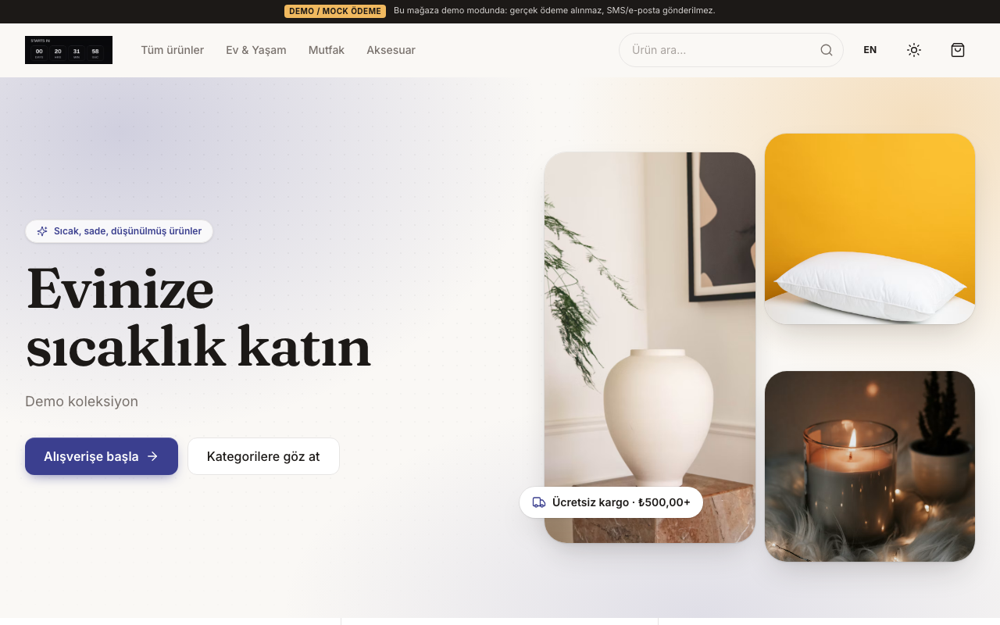
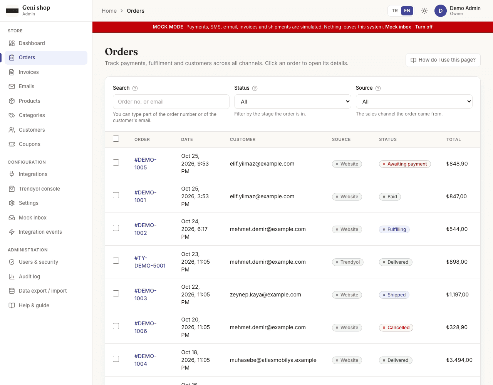

<div align="center">

<h1></h1>

**Mağazanız. Altyapınız. Özgürlüğünüz.**

Kendi Cloudflare hesabınızda, tek bir Worker ve D1 veritabanı üzerinde çalışan açık kaynak e-ticaret platformu.
Vitrin, yönetim paneli, pazaryeri, kargo, e-fatura ve bildirimler tek kurulumda.

[Türkçe](README.md) · [English](README.en.md)

[](LICENSE)
[](https://www.typescriptlang.org/)
[](https://workers.cloudflare.com/)
[](#entegrasyonlar)

[](https://deploy.workers.cloudflare.com/?url=https://github.com/berkayoztunc/openshelf)

</div>

<div align="center">

 

<sub>Vitrin (solda) ve yönetim paneli sipariş ekranı (sağda).</sub>

</div>

## İçindekiler

- [Neden OpenShelf](#neden-openshelf)
- [Özellikler](#özellikler)
- [Entegrasyonlar](#entegrasyonlar)
- [Hızlı başlangıç](#hızlı-başlangıç)
- [Yapılandırma](#yapılandırma)
- [Otomasyonlar ve zamanlanmış işler](#otomasyonlar-ve-zamanlanmış-işler)
- [Mock Modu](#mock-modu)
- [Mimari](#mimari)
- [Güvenlik](#güvenlik)
- [Geliştirme](#geliştirme)
- [Katkı ve lisans](#katkı-ve-lisans)

## Neden OpenShelf

Küçük ve orta ölçekli bir işletme; katalog, müşteri ve sipariş verilerini başka bir platforma teslim etmeden profesyonel bir mağaza işletebilmeli. OpenShelf **kendi Cloudflare hesabınıza** tek bir Worker olarak kurulur:

- **Tek dağıtım:** vitrin (`/`), yönetim paneli (`/admin/`) ve API (`/api/*`, `/webhooks/*`, `/media/*`, `/feeds/*`, `/mcp`) aynı Worker'dan sunulur.
- **Veri sizde:** tüm kayıtlar kendi D1 veritabanınızda; entegrasyon sırları AES-256-GCM ile şifreli saklanır.
- **Türkiye'ye hazır:** iyzico, Trendyol Pazaryeri, Trendyol e-Faturam, Geliver ve Netgsm hazır entegre; KDV, e-Arşiv ve KVKK akışları yerleşik.
- **Düşük işletme maliyeti:** sunucu, container ya da ayrı veritabanı yok; Cloudflare'in sunucusuz altyapısında çalışır.

## Özellikler

### Satış ve sipariş yönetimi
- **Sipariş listesi ve detayı:** ödeme, kargo, fatura ve bildirim geçmişi tek ekranda; durum geçişleri kurallı ve denetim kayıtlı.
- **Sipariş panosu:** siparişleri aşamalara göre (ödeme bekleniyor → ödendi → hazırlanıyor → kargoda → teslim edildi) gösteren kanban; her kartta ilerleme adımları ve tek tıkla işlemler.
- **Elden teslimat:** web sitesi siparişlerini kargo ve takip kodu olmadan teslim edildi olarak işaretleme; müşteriye yalnızca "teslim edildi" bildirimi gider.
- **Kargo etiketi ve belgeler:** 10×15, 10×10 ve 5×7 cm etiket boyutları (büyük barkod), paket fişi, sipariş özeti ve fatura kopyası.
- **İade:** tam veya kısmi iade, sağlayıcı üzerinden.
- **Kârlılık matrisi:** ürün/varyant bazında komisyon, kargo, maliyet, ödenecek KDV ve gelir vergisi sonrası net kâr; web sitesi ve Trendyol için ayrı parametreler.

### Katalog ve vitrin
- Ürünler, varyantlar, kategoriler, medya kütüphanesi, SEO ve yasal metinler.
- **Stok defteri:** yalnızca eklemeli stok hareketleri ve ödeme sırasında rezervasyon; eşzamanlı alışverişte fazla satış olmaz.
- **Vitrin düzeni:** ana sayfa ürünleri ve ürün sıralaması, mağazadaki ürün kartlarının aynısı üzerinde sürükle-bırak ile.
- **Kuponlar:** yüzde, sabit tutar ve **kargo bedava**; tahmin edilmesi zor kod üretici, kullanım ve müşteri başı limitler.

### Ödeme
- **Barındırılan ödeme sayfası:** kart bilgisi OpenShelf'e hiç uğramaz; fiyat sunucuda hesaplanır, ödeme doğrulanmış webhook ve sunucudan sunucuya sorgu ile onaylanır.

### İletişim
- **Markalı e-posta şablonları:** ürün satırları, ara toplam, indirim, kargo, KDV, ödeme ve adres bilgisi içeren düzenlenebilir TR/EN şablonlar.
- **İşlemsel SMS ve e-posta:** sipariş alındı, kargoya verildi, teslim edildi, iptal, iade ve yönetici bildirimi.
- **Kampanyalar:** izinli müşterilere e-posta/SMS kampanyası, abonelikten çıkma bağlantısı ile.

### Yönetim paneli
- **Genel bakış:** dönem KPI'ları, ciro grafiği, bugün yapılacaklar, son siparişler, satış dağılımı ve öne çıkanlar tek ekranda.
- **Genel arama (Ctrl/⌘+K):** sayfalar, ayarlar, hızlı işlemler, ürün, sipariş ve müşteri araması.
- **Rol tabanlı erişim:** sahip, yönetici ve personel; isteğe bağlı TOTP iki adımlı doğrulama.
- **TR/EN arayüz**, açık/koyu tema, daraltılabilir yan menü ve yerleşik kullanım kılavuzu.

### Yapay zekâ ile yönetim (MCP)
Mağazanın tüm yönetimi `https://<adresiniz>/mcp` adresinde bir MCP sunucusu olarak sunulur. Claude, ChatGPT, Grok ve diğer MCP istemcileri; erişim anahtarı veya OAuth 2.1 (PKCE) ile bağlanıp sipariş, ürün, kampanya ve ayarları yönetebilir. Araç bazında izin ve okuma/yazma/tam yetki seviyeleri vardır. Ayrıntılar: [docs/mcp.tr.md](docs/mcp.tr.md).

## Entegrasyonlar

Tüm entegrasyonlar yönetim panelinden etkinleştirilir; API anahtarları şifreli olarak D1'de saklanır.

| Entegrasyon | Kapsam | Doküman |
|---|---|---|
| **iyzico** | Barındırılan ödeme formu, webhook, iade | [iyzico](docs/integrations/iyzico.tr.md) |
| **Trendyol Pazaryeri** | Ürün eşleştirme ve aktarım, stok/fiyat senkronu, sipariş içe aktarma, iadeler, müşteri soruları, finans; 80+ işlemli API konsolu | [Trendyol](docs/integrations/trendyol.tr.md) |
| **Trendyol e-Faturam** | e-Fatura / e-Arşiv kesimi, iptal, gelen faturalar; isteğe bağlı sabit IP relay | [e-Faturam](docs/integrations/efaturam.tr.md) |
| **Geliver** | Çoklu kargo teklifi, etiket, otomatik kargo takibi (webhook + zamanlanmış kontrol) | [Geliver](docs/integrations/geliver.tr.md) |
| **Netgsm** | İşlemsel ve kampanya SMS'i | [Netgsm](docs/integrations/netgsm.tr.md) |
| **Twilio** | Uluslararası SMS | [Twilio](docs/integrations/twilio.tr.md) |
| **Cloudflare Email Service** | İşlemsel ve kampanya e-postası | [Cloudflare E-posta](docs/integrations/cloudflare-email.tr.md) |
| **Google Analytics 4** | Consent Mode v2, sunucu tarafı purchase (Measurement Protocol) | [GA4](docs/integrations/ga4.tr.md) |
| **Meta Pixel / CAPI** | Pixel + Conversions API, ürün kataloğu feed'i | [Meta](docs/integrations/meta.tr.md) |

Tarayıcı ve sunucu olayları ortak `event_id` ile tekilleştirilir; analitik ve reklam olayları yalnızca kullanıcı izni varsa gönderilir. Bkz. [docs/tracking.tr.md](docs/tracking.tr.md).

## Hızlı başlangıç

### Gerekenler

- Bir [Cloudflare hesabı](https://dash.cloudflare.com/sign-up)
- İki Worker sırrı:

| Ad | Nasıl üretilir | Ne işe yarar |
|---|---|---|
| `APP_ENCRYPTION_KEY` | `openssl rand -base64 32` | D1'deki entegrasyon bilgilerini şifreler. Güvenli bir yerde yedekleyin; kaybedilirse kayıtlı anahtarlar okunamaz. |
| `SETUP_TOKEN` | `openssl rand -hex 24` | `/admin/setup` ekranında sahip hesabını oluşturmak için tek seferlik anahtar. |

Entegrasyon bilgileri Worker sırrı değildir; kurulumdan sonra **Yönetim → Entegrasyonlar** ekranından girilir.

### 1. Deploy to Cloudflare

[](https://deploy.workers.cloudflare.com/?url=https://github.com/berkayoztunc/openshelf)

[Kurulum sayfası](https://berkayoztunc.github.io/OpenShelf/) sırları tarayıcıda üretir, butonu açar ve kurulumu (`/health`) kontrol eder. Buton:

1. Depoyu GitHub hesabınıza kopyalar ve Workers Builds'e bağlar.
2. [`wrangler.jsonc`](wrangler.jsonc) içindeki `DB` bağlamasından D1 veritabanını oluşturur.
3. `APP_ENCRYPTION_KEY`, `SETUP_TOKEN` ve isteğe bağlı `TURNSTILE_SECRET` değerlerini ister.
4. Derler, D1 migration'larını uygular ve tek Worker'ı yayınlar. Sonraki her push otomatik yayınlanır.

> Buton, depo GitHub'da herkese açık olduğunda çalışır. Kendi fork'unuz için adresteki `berkayoztunc` kısmını kendi kullanıcı/organizasyon adınızla değiştirin.

### 2. Rehberli CLI

```bash
pnpm install
pnpm run setup                           # giriş, D1, derleme, migration, deploy, sırlar
node tooling/setup/setup.mjs --dry-run   # çalıştırılacak komutları önizler
```

Tekrar çalıştırılabilir. Bayraklar: `--yes`, `--enable-r2`, `--skip-deploy`, `--domain=https://magaza.example.com`, `--db-name=AD`, `--local`, `--mock`. Tam rehber: [docs/deploy-cloudflare.tr.md](docs/deploy-cloudflare.tr.md).

### İlk açılış

1. `https://<adresiniz>/admin/setup` adresinde `SETUP_TOKEN` ile sahip hesabını oluşturun ve iki adımlı doğrulamayı açın.
2. **Ayarlar** ekranında mağaza adı, logo, marka renkleri, yasal metinler ve bildirim adreslerini girin.
3. **Entegrasyonlar** ekranından ödeme, kargo, fatura ve pazaryeri bağlantılarını etkinleştirin.
4. Kendi alan adınızı Cloudflare'de Worker'a bağlayın ve `STOREFRONT_ORIGIN`, `ADMIN_ORIGIN`, `API_ORIGIN` değerlerini sabitleyin.

## Yapılandırma

| Ad | Tür | Zorunlu | Amaç |
|---|---|---|---|
| `APP_ENCRYPTION_KEY` | sır | evet | 32 rastgele baytın base64 hali; entegrasyon bilgilerini şifreler |
| `SETUP_TOKEN` | sır | ilk kurulumda | `/admin/setup` için tek kullanımlık anahtar |
| `TURNSTILE_SECRET` | sır | hayır | ödeme ve giriş için Cloudflare Turnstile bot koruması |
| `STOREFRONT_ORIGIN`, `ADMIN_ORIGIN`, `API_ORIGIN` | değişken | önerilir | üretimde izinli origin'leri sabitler; tanımsızsa istek origin'i kullanılır |
| `ALLOW_MOCK` | değişken | hayır | Mock Modunun açılabilmesi için tanımlanır (demo/geliştirme) |
| `MEDIA` (R2) | bağlama | hayır | medya dosyaları için R2; tanımsızsa medya D1'de saklanır |

## Otomasyonlar ve zamanlanmış işler

Worker her 15 dakikada bir (`*/15 * * * *`) çalışır; yönetim panelinden başlatılan işler beklemeden hemen yürütülür.

| Sıklık | İş |
|---|---|
| 15 dakika | Süresi dolan stok rezervasyonları, Trendyol sipariş içe aktarma, Trendyol stok senkronu, iş kuyruğu (bildirimler, etiketler, pazaryeri güncellemeleri) |
| Saatlik | Geliver kargo takibi, Trendyol onay bekleyen ilanlar ve içerik/fiyat güncellemesi, cevapsız müşteri sorusu hatırlatıcısı, bakım |
| Anında | Ödeme webhook'u, Trendyol ve Geliver webhook'ları (bir sonraki turda işlenir), panelden başlatılan işler |

- **Kargo takibi:** Geliver gönderisi kargoya verilince sipariş "Kargoda", teslim edilince "Teslim edildi" olur ve müşteriye takip linkli bildirim gider.
- **Trendyol soruları:** cevap bekleyen sorular için yöneticiye, soru geldiğinde ve 24 saatlik cevap süresinin dolmasına 6 saat kala e-posta gider.
- **Fatura:** e-Fatura / e-Arşiv kesimi her zaman operatör onayıyla yapılır.

## Mock Modu

Mock Modu tüm dış sağlayıcıları çevrimdışı taklitlerle değiştirir; hiçbir hesap açmadan demo, eğitim ve geliştirme yapılabilir.

- Ödeme adımı, Başarılı / Başarısız / İptal seçenekli test ödeme sayfasına yönlenir.
- SMS, e-posta, fatura, kargo etiketi ve analitik olayları dışarı gönderilmez; yönetim panelindeki **Mock Inbox**'a yazılır.
- Gerçek bir ödeme sağlayıcısı etkinken veya gerçek ödenmiş sipariş varken açılamaz; mock ödemeler ayrıca işaretlenir.
- Yalnızca `ALLOW_MOCK` tanımlı Worker'da ve yalnızca sahip (owner) tarafından açılabilir.

Demo: `pnpm seed`, Mock Modunu açın, vitrinde sipariş verip test ödeme sayfasında **Başarılı**'ya basın. Rehber: [docs/mock-mode.tr.md](docs/mock-mode.tr.md).

## Mimari

```
 Tarayıcı ──► Cloudflare Worker (Hono) ◄──► D1 (SQLite)
               ├─ /             vitrin (React, statik)
               ├─ /admin/       yönetim paneli (React, statik)
               ├─ /api/*  /webhooks/*  /media/*  /feeds/*  /mcp
               └─ scheduled()  her 15 dakikada cron
                     │
                     ▼
               outbox iş kuyruğu ──► ödeme · kargo · fatura · pazaryeri
                                     analitik · SMS · e-posta adaptörleri
               isteğe bağlı: R2 (medya)
```

- **Outbox:** tüm dış çağrılar tekilleştirilmiş, yeniden denenebilir işler olarak kuyruğa alınır; bir sağlayıcının yavaşlığı ödemeyi ya da sipariş akışını bekletmez.
- **Durum makinesi:** sipariş geçişleri kurallıdır; stok, kupon ve bildirim yan etkileri aynı atomik işlemde uygulanır.
- **Adaptör SDK'sı:** her sağlayıcı ortak bir arayüzü uygular; yeni sağlayıcı eklemek için [docs/adapter-guide.tr.md](docs/adapter-guide.tr.md).

Ayrıntılar: [docs/architecture.tr.md](docs/architecture.tr.md).

## Güvenlik

- PBKDF2 parola özeti, isteğe bağlı TOTP MFA, `__Host-` oturum çerezi, CSRF ve Origin kontrolü
- Rol tabanlı yetki ve tüm yönetim işlemleri için denetim kaydı
- AES-256-GCM ile şifrelenmiş entegrasyon sırları ve dış istekler için host izin listesi
- Hız sınırları, isteğe bağlı Turnstile, imzalı/doğrulanmış webhook'lar
- KVKK: izin anlık görüntüleri, müşteri anonimleştirme, abonelikten çıkma

Ayrıntılar: [docs/security.tr.md](docs/security.tr.md). Güvenlik açıklarını [SECURITY.md](SECURITY.md) uyarınca özel olarak bildirin.

## Geliştirme

Gereksinimler: Node ≥ 20, pnpm.

```bash
pnpm install
pnpm setup:local     # .dev.vars dosyalarını yazar, yerel D1'e migration uygular
pnpm seed            # isteğe bağlı demo mağaza
pnpm dev             # vitrin :5173 · yönetim :5174/admin/ · API :8787
```

| Komut | Ne yapar |
|---|---|
| `pnpm dev` | API, vitrin ve yönetim geliştirme sunucuları |
| `pnpm dev:site` | tek Worker düzeninde yerel önizleme |
| `pnpm build` | tüm paketleri derler ve `dist-site/` klasörünü hazırlar |
| `pnpm run deploy` | uzak D1 migration'larını uygular, ardından `wrangler deploy` |
| `pnpm run setup` / `pnpm setup:local` | rehberli yayın / yerel kurulum |
| `pnpm seed` | yerel D1'e demo veri yükler |
| `pnpm db:generate` / `pnpm db:migrate:local` | migration üretir / uygular |
| `pnpm typecheck` / `pnpm test` / `pnpm format` | kalite kontrolleri |

### Proje yapısı

```
apps/storefront     vitrin (React + Vite)
apps/admin          yönetim paneli (React + Vite, /admin/ altında)
workers/api         Hono API, webhook'lar, MCP sunucusu, cron, D1 migration'ları
packages/           core, db, shared, ui, integration-sdk, integrations/*
tooling/            kurulum, demo verisi ve dağıtım betikleri
docs/               rehberler (Türkçe ve İngilizce)
wrangler.jsonc      tek Worker yapılandırması
```

### Maliyet

Çekirdek (Worker, D1 ve statik dosyalar) küçük bir mağaza için Cloudflare'in ücretsiz planına sığacak şekilde tasarlanmıştır; trafik ve sipariş hacmi arttıkça Workers Paid önerilir. Cloudflare Email Service ile herhangi bir alıcıya e-posta göndermek Workers Paid gerektirir. Ödeme, kargo, fatura, SMS ve pazaryeri hizmetleri kendi tarifeleriyle ücretlendirilir. Güncel limitler: [Workers](https://developers.cloudflare.com/workers/platform/limits/), [D1](https://developers.cloudflare.com/d1/platform/limits/).

## Yol haritası

- `create-openshelf` CLI (`npx create-openshelf@latest`)
- Outbox için Cloudflare Queues adaptörü
- Yeni ödeme, kargo ve pazaryeri sağlayıcıları

## Katkı ve lisans

Katkılar memnuniyetle karşılanır: [CONTRIBUTING.md](CONTRIBUTING.md) ve [CODE_OF_CONDUCT.md](CODE_OF_CONDUCT.md). OpenShelf [MIT](LICENSE) lisanslıdır. Şablonlar ve dokümanlar hukuki veya vergisel danışmanlık yerine geçmez.
